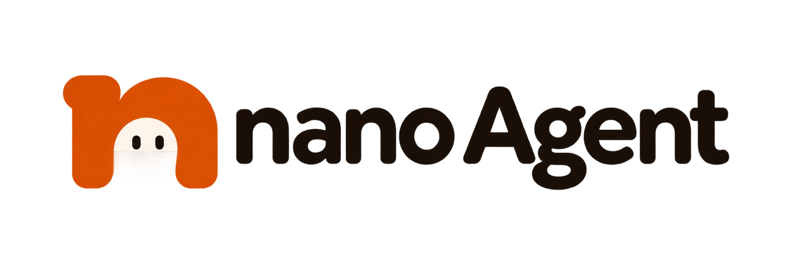

# nano Agent

**A personal AI assistant you run on your own computer.** Use an API provider or a local model, then talk through the private web console or optionally LINE. nano Agent keeps its database and settings in your home directory and asks before sending messages or applying code changes.



## Quick start

The installer supports Linux, macOS and WSL. Native Windows is not supported in this preview. It installs an isolated command and starts the setup wizard; it does not use sudo or edit shell startup files.

```bash
curl -fsSL https://raw.githubusercontent.com/julachok20/nano-agent/main/install.sh -o install.sh # scan:allow
less install.sh
bash install.sh
```

Choose a model provider in setup. API keys are entered privately and stored separately from `config.toml`. To run a local model server, choose an OpenAI-compatible provider and enter its local base URL. After setup, open the private console URL printed by the installer. Start and inspect the service with:

```bash
nano-agent status
nano-agent doctor --offline
nano-agent logs --follow
```

To remove nano Agent, run `nano-agent uninstall`; review its prompt carefully because it can remove the local data directory.

## What it can do

- Use OpenAI-compatible, Anthropic, Gemini, Ollama and fake/test model providers.
- Chat, use registered tools, keep owner-controlled memory and skills, and show background work in the console.
- Prepare LINE replies and other outbound actions as drafts for owner approval.
- Propose bounded code changes, run checks, and wait for owner approval before applying them.
- Run locally with optional Google, MCP, system metrics, keyring and Docker sandbox integrations.

## Screenshots

The project includes the console logo and icon in `assets/`. A sample-data console preview is generated with `python scripts/preview_console.py`; it writes local screenshots and does not connect to an account or provider.

## Safety and privacy

The console binds to `127.0.0.1` by default. Keep it private unless you deliberately configure an exposure method. LINE uses the official Messaging API; personal LINE browser automation is outside this project. Inbound chat and fetched web content are untrusted. See [SECURITY.md](SECURITY.md) and [docs/EXPOSURE.md](docs/EXPOSURE.md) before exposing a webhook.

Live provider calls, Google authorization, LINE delivery and MCP-client interoperability depend on your own accounts and are not covered by the local fake-provider checks. Docker is optional and only used for the code sandbox when enabled.

## Development

```bash
python -m pip install -e ".[dev]"
ruff check src tests scripts
pytest
python scripts/secrets_scan.py
python scripts/e2e_check.py
```

See [docs/INSTALL.md](docs/INSTALL.md), [docs/CONFIG.md](docs/CONFIG.md), and [docs/ARCHITECTURE.md](docs/ARCHITECTURE.md). Contributions are welcome; read [CONTRIBUTING.md](CONTRIBUTING.md) and [SECURITY.md](SECURITY.md) first.

## Project status

Early alpha, version `0.1.0a1`. Interfaces and configuration may change. The roadmap covers the optional Windows LINE bridge, team bridge, and model fine-tuning research. See [ROADMAP.md](ROADMAP.md) and [CHANGELOG.md](CHANGELOG.md).

## License

MIT. See [LICENSE](LICENSE).
