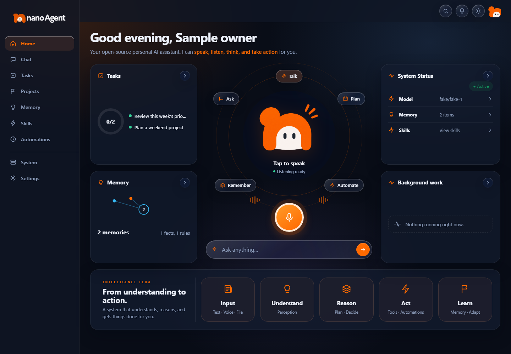
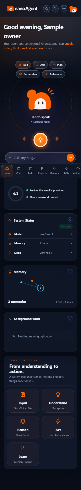
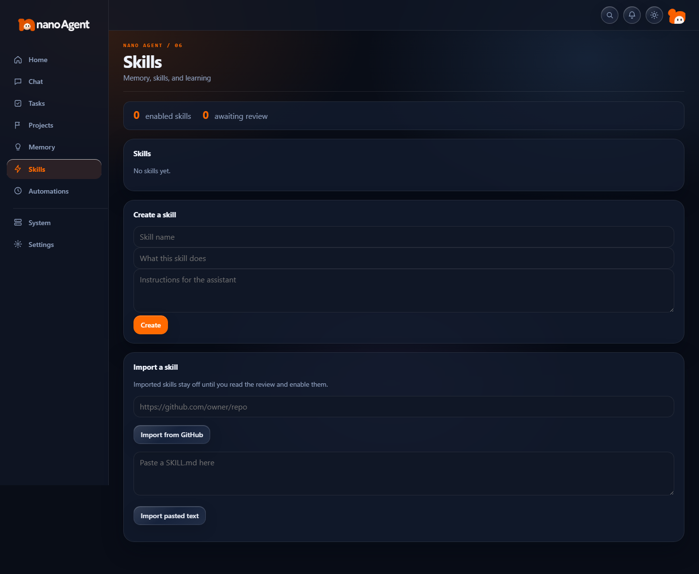

# nano Agent

**A personal AI assistant you run on your own computer.** Use an API provider or a local model, then talk through the private web console or optionally LINE. nano Agent keeps its database and settings in your home directory and asks before sending messages or applying code changes.


## Quick start

The installer supports Windows, Linux, macOS and WSL. It installs an isolated command and opens the terminal setup wizard. It does not request administrator rights or edit your shell profile.

From a local checkout, run **Windows PowerShell**:

```powershell
.\install.ps1
```

Or **Linux, macOS, or WSL**:

```bash
bash install.sh
```

When the GitHub repository is public, the OpenClaw-style one-line install is:

```bash
curl -fsSL https://raw.githubusercontent.com/julachok20/nano-agent/main/install.sh | bash
```

The repository is currently private, so this hosted command returns 404 until its visibility changes. The local command above works now.

Choose **Quick setup** for language, model, key, and connector choices; the dashboard stays local. Both setup modes ask whether to connect LINE now, later, or use only the dashboard and terminal chat, and whether to prepare Google for later. **Custom setup** also exposes network and storage choices. API keys are entered privately and stored separately from `config.toml`. To run a local model server, choose an OpenAI-compatible provider and enter its local base URL. The interactive installer and setup use temporary terminal screens so their steps leave no scrollback when you finish. nano Agent then opens the dashboard and starts terminal chat. Next time, run `nano-agent launch` (or just `nano-agent` in a terminal). Type `/dashboard` in chat to reopen the browser and `/quit` to leave chat; the dashboard keeps running. Inspect the service with:

```bash
nano-agent status
nano-agent doctor --offline
nano-agent logs --follow
```

To stop and remove the installed command while keeping local data, run `nano-agent uninstall`. Only `nano-agent uninstall --purge` deletes the local data directory, after confirmation. Back it up first.

The hosted install URLs in [the install guide](docs/INSTALL.md) work only after the repository and its `main` branch are published. A private or missing repository returns 404 to an unauthenticated download.

## What it can do

- Use OpenAI-compatible, Anthropic, Gemini, Ollama and fake/test model providers.
- Chat, use registered tools, keep owner-controlled memory and skills, and show background work in the console.
- Prepare LINE replies and other outbound actions as drafts for owner approval.
- Propose bounded code changes, run checks, and wait for owner approval before applying them.
- Run locally with optional Google, MCP, system metrics, keyring and Docker sandbox integrations.
- Track projects in the console with goals, deadlines, milestones, blockers, notes, and decisions.
- View local tasks, reminders, and project dates on a day, week, or month calendar; inspect memory as text or a graph.

## Screenshots

The project includes the console logo and icon in `assets/`. These screenshots use a temporary fake-provider home and no personal account.







Choose **Light** or **Dark** in Settings → Appearance. The choice is saved locally. The console includes Chat, Tasks, Projects, Memory, Skills, Automations, System, and Settings. See [Projects](docs/img/console-projects.png), [Calendar](docs/img/console-calendar.png), [Memory graph](docs/img/console-memory-graph.png), [Automations](docs/img/console-automations.png), and [Chat](docs/img/console-chat.png) previews.

Recreate them with `python scripts/preview_console.py --screenshots --out docs/img` after installing Playwright Chromium.

## Safety and privacy

The console binds to `127.0.0.1` by default. Keep it private unless you deliberately configure an exposure method. LINE uses the official Messaging API; personal LINE browser automation is outside this project. Inbound chat and fetched web content are untrusted. See [SECURITY.md](SECURITY.md) and [docs/EXPOSURE.md](docs/EXPOSURE.md) before exposing a webhook.

Live provider calls, Google authorization, LINE delivery and MCP-client interoperability depend on your own accounts and are not covered by the local fake-provider checks. Docker is optional and only used for the code sandbox when enabled.

## Development

```bash
python -m pip install -e ".[dev]"
ruff check src tests scripts
pytest
python scripts/secrets_scan.py
python scripts/e2e_check.py
```

See [docs/INSTALL.md](docs/INSTALL.md), [docs/CONFIG.md](docs/CONFIG.md), and [docs/ARCHITECTURE.md](docs/ARCHITECTURE.md). Contributions are welcome; read [CONTRIBUTING.md](CONTRIBUTING.md) and [SECURITY.md](SECURITY.md) first.

## Project status

Early alpha, version `0.1.0a1`. Interfaces and configuration may change. The roadmap covers the optional Windows LINE bridge, team bridge, and model fine-tuning research. See [ROADMAP.md](ROADMAP.md) and [CHANGELOG.md](CHANGELOG.md).

## License

MIT. See [LICENSE](LICENSE).
